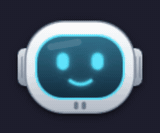
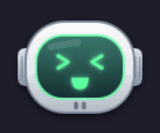
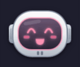
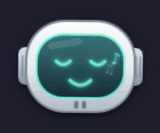
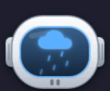
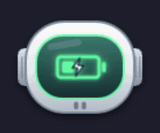
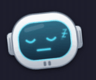
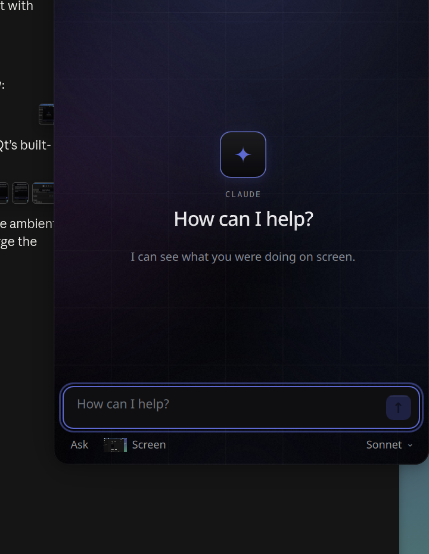
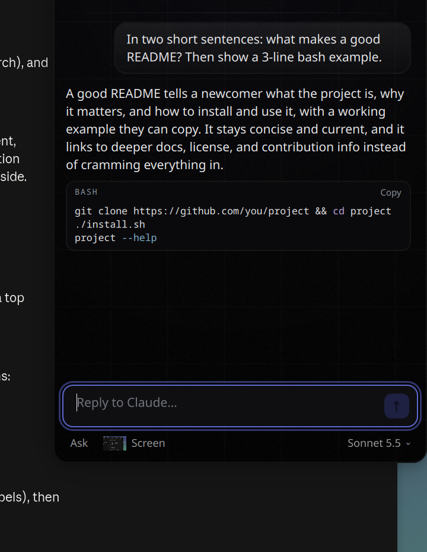

# Visor 🤖

A small robot in a space helmet that lives in the corner of your Wayland desktop. It shows what your AI tools are doing (thinking, working, waiting for you, done), chats with you in a popup that can see your screen, and reacts to everything else on the computer: music, battery, Wi-Fi, USB, the weather, and you petting it with the mouse.

It works with **Claude Code** and **any OpenAI-compatible API**: OpenAI, OpenRouter, Gemini, Mistral, Groq, and local models through Ollama, LM Studio or llama.cpp. Adding another AI is a small adapter ([docs/PROTOCOL.md](docs/PROTOCOL.md)).

https://github.com/user-attachments/assets/c9e1ed1a-7d31-4f99-b424-fa3b8ff7ec65


| | | | | |
|:-:|:-:|:-:|:-:|:-:|
| <br>idle | <br>thinking | <br>working | <br>needs you | <br>done |
| <br>petting | <br>music | <br>weather | <br>battery | <br>you're away |

All the faces and what triggers them: [docs/faces.md](docs/faces.md).

 

## What it does

- **Follows your AI.** Moods come from adapters: Claude Code hooks, the Codex CLI notify script, or `visor signal` from anything else. When a long task finishes or needs approval, a speech balloon tells you, and clicking it opens that chat.
- **Chat popup.** Click the robot. Replies stream in, tool calls fold into one line, and permission requests and questions appear as buttons. It can look at what you were doing on screen when a question needs it, and only then (the Screen chip turns that off completely). There's a model picker, a permission-mode switch (Ask, Edits, Auto, Plan) and a list of recent chats.
- **Optional computer use** on Hyprland: the AI can click, type and switch windows for you, asking first.
- **Lives with you.** It bops along to music (MPRIS), gets sleepy at night, naps when you're away, greets you with the weather, and notices chargers, Bluetooth headphones, USB devices and volume changes. With the AI's help, its remarks are freshly written every few hours.
- **Light.** About 11 % of one CPU core while animating, with no daemons beyond Quickshell.

## Install

Needs a Wayland compositor with layer-shell (Hyprland, Sway, niri, river, Plasma…), [Quickshell](https://quickshell.org) and Python 3. Optional: the Inter font (`inter-font` on Arch), a Nerd Font for the system-event icons (`ttf-nerd-fonts-symbols-mono`), `jq` (Claude Code hook), `grim` (screenshots), `curl` (weather), `brightnessctl`, and `wtype` (computer use).

```sh
git clone https://github.com/goncaloMgomes/visor && cd visor
./install.sh                 # → ~/.local/share/visor and ~/.local/bin/visor
visor doctor                 # what works on this machine
visor setup claude-code      # if you use Claude Code: adds the hooks (backs up settings.json)
visor                        # start it
```

To start it with your desktop, use `systemctl --user enable --now visor.service`, or `exec-once = visor` (Hyprland) / `exec visor` (Sway). See [docs/hyprland.md](docs/hyprland.md) for placement, brightness keys and the Hyprland extras.

## Configure

`~/.config/visor/config.json` (created by `visor setup config`). Only include what you change; every option and its default is in [`backend/common.py`](backend/common.py).

```json
{
  "name": "Sam",
  "backend": "claude-code",
  "chat": { "model": "sonnet", "permissionMode": "default", "computerUse": false },
  "position": { "marginTop": 0, "marginRight": 64 }
}
```

| Key | What |
|---|---|
| `name` | your name in greetings |
| `backend` | `claude-code` or `openai` (configure it under `backends.openai`, see [PROTOCOL.md](docs/PROTOCOL.md#included)) |
| `theme` | `linear` (default: near-black glass, indigo ambient light, layered shadows), `claude`, or a path to your own JSON (see [Themes](#themes)); `themeOverrides` changes single tokens |
| `reducedMotion` | turn animations off (also automatic when the desktop's "enable animations" setting is off) |
| `chat.permissionMode` | Claude Code's mode for popup chats: `default` asks before acting, `acceptEdits`, `auto`, `plan` |
| `chat.computerUse` | let the chat AI drive the desktop (Hyprland, opt-in) |
| `chat.shareScreen` | let the AI look at your screen when it needs to (`false` = never; the Screen chip in the composer turns it off for the moment) |
| `service` | `{ "unit": "x.service", "label": "X" }`: the robot sleeps while that systemd user unit is stopped, and a click starts it |
| `waybar.makeRoom` | on the first start, shove Waybar over to make room (`false` to leave the bar alone; it also leaves it alone once you set `position`) |
| `features` | `weather`, `remarks` (AI-written balloon lines) |
| `night`, `idleSeconds`, `lockers`, `power` | sleepy hours, the away timer, screen lockers to watch for, battery names (`auto`) |

The weather city, the speech balloons switch and a **Settings** page for the everyday options are in the right-click menu (`visor` writes those back to the config file). Changes to the config file apply right away.

## Themes

The popups are styled entirely from design tokens: colours, fonts, radii, which effects are on, and the light pools. Each theme is a JSON file in `themes/`; `quickshell/Style.qml` lists every token with its default. A theme only needs the tokens it changes, because the rest come from `linear`. The effects (ambient light, grid, noise, cursor spotlight, layered shadows, gradient text) are switched by `effects` in the theme, so a flat theme like `claude` uses the same components without them.

## Commands

```
visor [start] | stop | restart | log
visor ipc chat | say TEXT | menu | curious | city NAME | …     drive it from scripts
visor signal <mood> | --event start|stop|ask|error …          report what an AI tool is doing
visor setup config | claude-code [--remove] | codex | waybar [--remove]
visor doctor
```

## Privacy

Nothing leaves your computer except:

- **chat messages**, sent to the AI you configured, plus a screenshot only when the AI decides it needs to look and sharing is on;
- **the weather city**, sent to wttr.in;
- **the AI-written lines**: a short prompt with the time of day and the weather, sent to your AI every 2.5 hours (`features.remarks: false` turns it off).

## Uninstall

`./uninstall.sh` (add `--purge` to delete your config and chats too). It also removes the Claude Code hooks and gives Waybar its room back.

## License

MIT. Visor is an independent project and isn't affiliated with Anthropic, OpenAI or any other AI provider. The optional `claude` theme only imitates the colours of Claude's apps for people who use them.
