# Faces and behaviour

Everything the robot does, with a GIF of each face.

## Faces

Every face shares the same helmet: a white shell with ear pods, a dark visor, glowing eyes and mouth, and a soft glow in the face's colour. The robot always bobs gently up and down, blinks every 2 to 6 seconds, and glances around. Each face changes the eye shape, mouth, colour, head tilt and how much it looks around, and some add an effect or show an icon in the visor instead of the face.

### AI faces

These follow what your AI tools are doing, through their adapters (the Claude Code hooks, the Codex notify script, or anything calling `visor signal`, see [PROTOCOL.md](PROTOCOL.md)).

| | Face | When | Looks like |
|:-:|---|---|---|
|  | **idle** | Nothing is happening (the normal face). Its eyes follow the mouse while it moves. | Cyan oval eyes and a small smile. Calm glances around. |
|  | **thinking** | You sent a prompt, or a tool just finished and the AI is thinking again. | Purple. A thought bubble with typing dots. |
|  | **working** | The AI is running a tool (editing, searching, running commands) or a subagent started. | Blue. Eyes dart around quickly, as if reading. |
|  | **input** | The AI needs you: a permission prompt, a question, or plan approval. | Amber. A big wobbling **?**. Stays until you answer. |
|  | **done** | The AI finished its turn. Shows for 3.5 s, then goes back to normal. | Green. `> <` squinty eyes and a big open grin. |
| 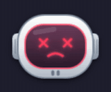 | **error** | The turn failed (API error and the like). Shows for 4 s, then goes back to normal. | Red. `× ×` eyes and a frown. |
| 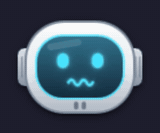 | **nervous** | A tool call failed. | Wavy mouth, eyes darting. |
|  | **sleep** | You've been away from the computer for 4 minutes (no mouse or keyboard). Wakes with a yawn as soon as you touch anything. | Eyes closed, head drooping, "z"s floating up, dim glow. |
| 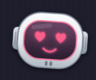 | **love** | Not used by anything right now. Available to adapters: `visor signal love`. | Pink heart eyes. |

### Interaction

| | Face | When | Looks like |
|:-:|---|---|---|
|  | **pet** | The mouse is over the robot, which counts as petting. | Pink. `^ ^` happy eyes, open smile, blushing. It leans toward the mouse and its eyes follow your hand. |
| 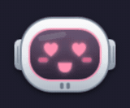 | **purr** | You keep stroking it from side to side. Affection builds up and then fades when you stop. | Heart eyes, a happy wiggle and a brighter glow. |
| 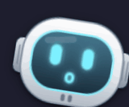 | **curious** | About 1 in 6 of your clicks anywhere on the screen (at most once every 20 s), while it's idle. Lasts 1.6 s. | A quick tilted "hm?": wide eyes, an "o" mouth, looking at where you clicked. |
| 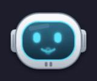 | **talking** | The speech balloon is typing a message. Works with any face. | The mouth flaps open and shut in time with the typing. |
| 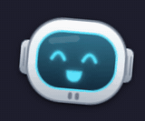 | **greet** | A greeting (boot or unlock) when there's no weather face to show. | Happy eyes, big smile, head tilted, looking toward the balloon. |

### Everyday life

These only show while the AI is idle; anything it is doing comes first.

| | Face | When | Looks like |
|:-:|---|---|---|
|  | **music** | Anything is playing through MPRIS (Spotify, browser, mpv…). | Mint green. Eyes closed, smiling, nodding to a beat with musical notes. |
| 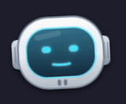 | **sleepy idle** | Not a separate face: the idle face itself gets sleepier from 21:00, is fully sleepy from 00:30 to 05:00, and is wide awake again by 07:00 (the `night` settings). | Heavier eyelids, a smaller smile, a dimmer glow and a drooping head, more so as the night goes on. |
| 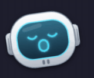 | **yawn** | When you come back after being away, now and then late at night (every 8 to 15 minutes while it's quite sleepy), and while the service is starting. | Eyes closed, head tilted back; the mouth slowly opens wide, holds, then closes. |

### System events

A glowing icon pops into the visor for about 2 seconds when something changes on the computer. These don't need the AI to be idle.

| | Event | Looks like |
|:-:|---|---|
| 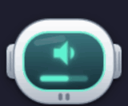 | **Volume** (Pipewire): changing it or muting | Mint speaker with a level bar; a crossed-out speaker when muted. |
| 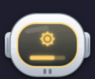 | **Brightness**: the brightness keys (bound to `scripts/sysevent.sh`) | Yellow sun with a level bar. |
| 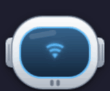 | **Wi-Fi** on or off | Blue Wi-Fi icon with a ripple; it sags when switched off. |
| 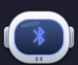 | **Bluetooth** on or off, and **a device connecting** (headphones and the like) | Indigo Bluetooth icon with a ripple. |
| 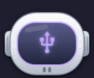 | **USB device** plugged in | Lilac USB icon that wiggles in. |
| 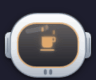 | **Keep-awake** on or off (`scripts/sysevent.sh caffeine on\|off`) | A steaming coffee cup. When it's switched off, a yawn follows. |

### Service (optional)

With `service.unit` set in the config, the robot represents that systemd user service (for example Claude Code Remote Control) and checks it every 5 seconds. Without one these faces never show.

| | Face | When | Looks like |
|:-:|---|---|---|
| 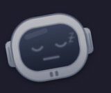 | **off** | The service isn't running. Nothing else can change the face: no petting, battery or AI faces. | Grey, dimmed and fast asleep with "z"s. **Click it to start the service.** |
|  | **waking** | You clicked it and the service is starting (up to 45 s). | A long yawn. It stretches once it's up and then returns to normal. |

### Weather

The weather comes from [wttr.in](https://wttr.in) for the city you set in the [right-click menu](#right-click-menu); without a city there's no weather at all. It's checked every 30 minutes, and again after the computer wakes from suspend if the last check is older than that.

Weather faces have **no eyes or mouth**: the visor shows only a glowing weather widget, for about 8 seconds alongside a balloon message. They can interrupt a working face, but never a question or an error. Petting the robot during one brings its normal face back.

| | Face | Weather | Widget |
|:-:|---|---|---|
| 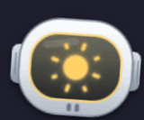 | **sunny** | Clear or partly cloudy, between sunrise and sunset. | Yellow. A sun with slowly turning rays. |
| 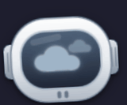 | **cloudy** | Cloudy or overcast. | Grey. A big cloud with a smaller one behind, both drifting. |
|  | **rainy** | Rain, drizzle or showers. | Blue. A cloud with rain falling from it. |
| 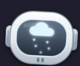 | **snowy** | Snow, sleet or ice pellets. | Icy white. A cloud with snowflakes drifting down. |
| 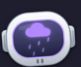 | **stormy** | Thunder, or rain or snow with thunder. | Purple. A cloud with rain and a flashing lightning bolt; the whole visor flashes too. |
| 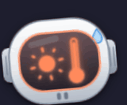 | **hot** | 30 °C or more, when it isn't raining or snowing. | Orange. A small sun and a nearly full thermometer, with a sweat drop running down the helmet. |
| 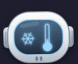 | **cold** | 3 °C or less, when it isn't snowing. | Pale blue. A turning snowflake and an almost empty thermometer; the whole robot shivers. |
| 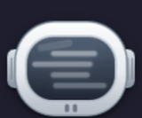 | **foggy** | Fog or mist. | Grey. Soft bands sliding back and forth. |

Whether it's day or night is decided when the message is said, from that day's sunrise and sunset. A clear night gets a message but no face.

### Battery

| | Face | When | Looks like |
|:-:|---|---|---|
|  | **battery** | Laptops only (the battery is found automatically). Only briefly (3.5 s): when the charger is plugged in or removed, when the level drops past 20 %, 10 % or 5 %, and every 5 minutes while it's at 20 % or below on battery. | A battery icon in the visor with the level and a ⚡ while charging. Green while charging or above 40 %, amber from 21 % to 40 %, red at 20 % or below (blinking). |

---

## Which face wins

From highest to lowest priority:

1. **Service off** (if one is configured) → *off* or *waking*. Nothing overrides it.
2. **Petting** → *pet* or *purr*, over anything.
3. **The AI's state** from the adapters. *input* stays until the AI moves on, and nothing short-lived may cover it or a showing *error*.
4. **Short peeks** (weather, battery, system events, greeting, yawn, curious, *done*, *error*). These play for a few seconds and then return to whatever should be showing. Calm peeks (yawn, curious) only happen while the face is calm. Urgent ones (weather, battery, system events, greeting, waking up) may also cover *thinking* or *working*.
5. **Everyday state** while the AI is idle: *sleep* if you're away, *music* if something is playing.
6. **idle**, the normal face (sleepier at night).

The robot hides itself when something is fullscreen (videos, games, a screensaver). The chat and the menu close too.

---

## Speech balloon

A white cartoon speech bubble with an ink outline and a tail pointing at the robot, just below it. It pops out of the tail with a springy bounce and types its message like a person, with pauses after commas and full stops. The robot's mouth moves while it types.

- **Click** while it's typing to show the whole message at once; click again to close it. If it's about a chat, that chat opens in the popup.
- **Hover** to keep it open.
- One message at a time; the rest wait in a queue (while you're locked, something is fullscreen, or the chat or menu is open). Chit-chat that waited more than 30 s is dropped.
- **Speech balloons can be switched off** in the right-click menu. The face still reacts.

| Event | Example |
|---|---|
| **Boot / unlock** (with a weather city set, at most every 3 h) | "Good afternoon, Sam! ☀️ Sunny and 22°C in Lisbon! Sunglasses on 😎" |
| **Unlock** with news | "Welcome back! While you were away, “Fix the login bug” finished." |
| **Answer ready** (a turn that took 20 s or more) | "“Refactor parser” is done ✓" |
| **Needs approval** | "“Deploy script” needs you" (click the balloon to open it) |
| **Error** | "“…” hit an error" |
| **Charger / battery** | "Power snack time! 64% and climbing.", "Mayday, mayday! 5% battery!" |
| **Wi-Fi, Bluetooth, USB, keep-awake** | "Wi-Fi's back! Hello, internet 🌐", "Ooh, WH-1000XM4 connected! 🎧" |
| **Music starts** (after 2 min of silence) | "🎶 Ooh, “Get Lucky” by Daft Punk! Good taste." |
| **Late at night**, **petting**, **purring** | "Night owl mode activated.", "Boop!", "Purrrrr… 💕" (only when you actually stroke it, and rarely: at most once an hour) |

**AI-written lines.** With `features.remarks` on, every 2.5 hours (and when the weather changes) `backend/remarks.py` asks the configured AI for a fresh pool of lines per kind of event, knowing the time of day and the weather. Without it, or if the pool is older than 8 hours, the robot uses its hand-written lines.

---

## Right-click menu

- **Speech balloons** on/off.
- **Weather city**: type "City, Country" and press Enter. Weather comes from [wttr.in](https://wttr.in); without a city there's none.
- With a service configured: its status, and **Start / Restart / Stop** (Restart and Stop ask for a second click).

---

## Mouse controls

| Action | What happens |
|---|---|
| Hover the robot | Petting: happy face, leans toward the cursor |
| Move side to side while hovering | Builds up purring: heart eyes and a wiggle |
| Click | Opens or closes the chat popup (or starts the service, if it's off) |
| Right-click | Opens the menu |
| Click the balloon | Shows the full message, or closes it and opens the related chat |
| Click anywhere else | Sometimes a curious look (needs the Hyprland Lua snippet) |
